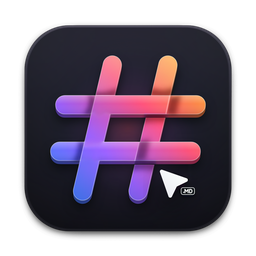
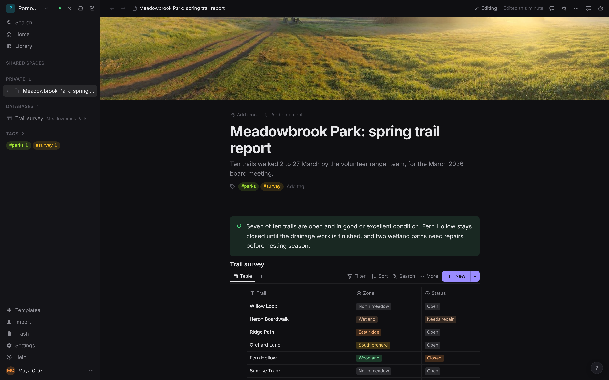
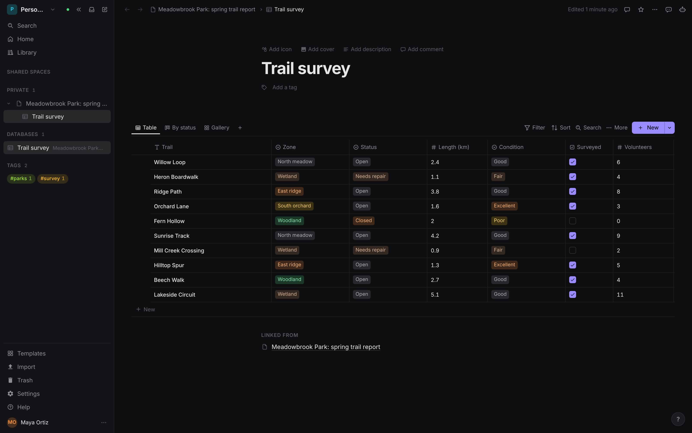
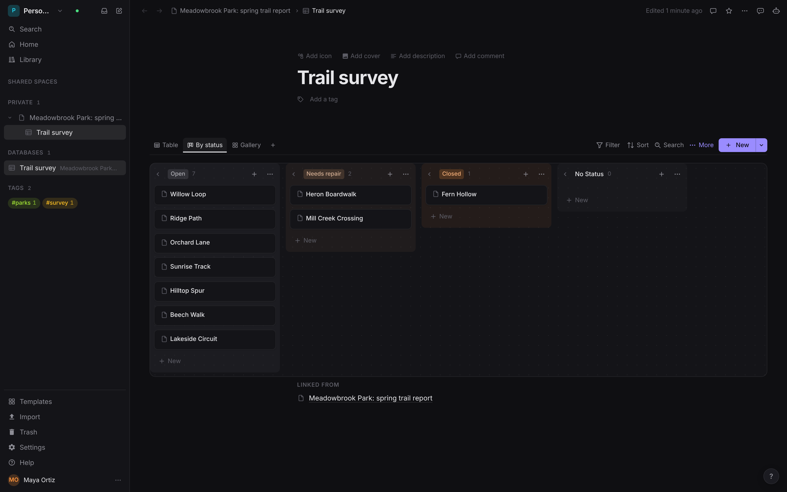
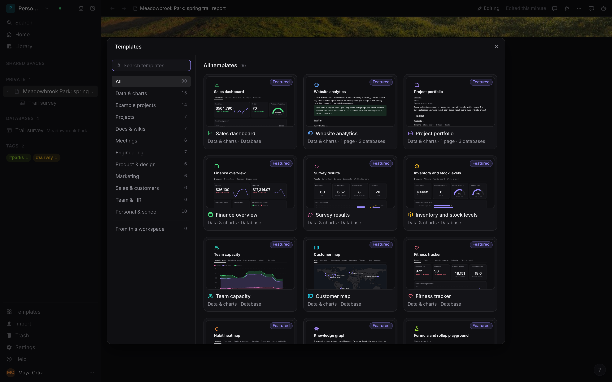

<p align="center">
  
</p>

<h1 align="center">form.md</h1>

<p align="center">
  <b>Workspace; documents, databases and realtime editing for people and agents.</b><br>
  Pages, seven database views, comments, sharing and publishing,<br>
  in one Go binary with one SQLite file. Self-hosted, no account elsewhere.
</p>

<p align="center">
  
  
  
  
  
  
</p>

<p align="center">
  <a href="https://formmd.formai.studio/"><b>Download form.md on formai.studio</b></a> ·
  <a href="https://github.com/nodemode-dev/formcompiler/releases/tag/form.md-v0.47.7">Latest release</a> ·
  <a href="#run-it-from-source">Run it from source</a>
</p>

<br>

<p align="center">
  <br>
  <sub>An original report page: a cropped photo cover, a callout and a live database view, in the editor.</sub>
</p>

<p align="center">
  <a href="#features">Features</a> · <a href="#everything-in-the-box">In the box</a> · <a href="#built-for-agents">Agents</a> · <a href="#under-the-hood">Under the hood</a> ·
  <a href="#download">Download</a> · <a href="#run-it-from-source">Run from source</a>
</p>

<br>

<table>
  <tr>
    <td width="25%" valign="top"><h3>One binary</h3>A static Go binary with the web client embedded and one SQLite file beside it. No database server.</td>
    <td width="25%" valign="top"><h3>Server-held documents</h3>Every page is a CRDT the server applies itself, so an API edit merges into what a person is typing.</td>
    <td width="25%" valign="top"><h3>Rows are pages</h3>Seven database views on one query engine, with relations, rollups and formulas.</td>
    <td width="25%" valign="top"><h3>Agent-ready</h3>An MCP server with OAuth, a REST API and a command line drive the same workspace.</td>
  </tr>
</table>

<br>

## Features

<table>
  <tr>
    <td width="50%" valign="top">
      
      <br><sub>The same rows, as a table with typed columns.</sub>
      <h3>Seven database views</h3>Every row is a page. Switch one query between table, board, list, gallery, calendar, timeline and form.
    </td>
    <td width="50%" valign="top">
      
      <br><sub>A board grouped by the Status property.</sub>
      <h3>Boards that follow the data</h3>Group by any select, drag rows between columns and add views without copying anything.
    </td>
  </tr>
  <tr>
    <td width="50%" valign="top">
      
      <br><sub>The template gallery.</sub>
      <h3>Starts with 90 templates</h3>Documents, databases, dashboards and example projects, each previewed before you add it.
    </td>
    <td width="50%" valign="top">
      <h3>Edit together, share exactly</h3>Comments, suggested edits, history and six access levels, enforced by the server on every route. Publish a page as a site when you want it public.
    </td>
  </tr>
</table>

## Everything in the box

<table>
  <tr>
    <td width="33%" valign="top"><h4>Documents</h4>Block editor · slash menu · callouts · toggles · tables · columns · code · mentions · backlinks</td>
    <td width="33%" valign="top"><h4>Databases</h4>Table · board · list · gallery · calendar · timeline · form · heatmap · graph · charts · automations</td>
    <td width="33%" valign="top"><h4>Formats</h4>Opens: Markdown · HTML · CSV · ENEX · OPML · Word · Excel · Saves: Markdown · HTML · PDF · CSV</td>
  </tr>
</table>

## Built for agents

The window's commands, the REST API and the MCP server all act on the same pages and databases.

```sh
./form-md cli list              # every command in the open window
./form-md cli describe ID       # one command with its typed parameters
./form-md mcp                   # MCP server on stdio for Claude Code, Codex and Cursor
```

`.mcp.json` and `.cursor/mcp.json` are already wired in this repo. The server also answers MCP over HTTP at `/mcp` and publishes its REST reference at `/api/docs`. See [`AGENTS.md`](AGENTS.md).

## Extensions

form.md loads Form extensions (Form Extension Contract, API 1): install them with FormPortal, or run a folder from form.ext. They appear under Extensions in the sidebar (and the desktop menu bar), in the Extensions panel on the right and in Find a Command; each runs in a sandboxed frame and changes the page only through form.md's own `doc.*` commands, as one undo step, after you allow it. Agents reach them with the MCP tools `extensions_list` and `extension_command`, or `./form-md cli extensions`. The API for extension authors is [`docs/EXTENSIONS.md`](docs/EXTENSIONS.md); the wiki page is Extensions.

## Under the hood

- **Go server:** pure-Go SQLite, a Yjs-compatible CRDT in Go, one writer connection and a query-only reader pool.
- **Web client:** vanilla TypeScript and Vite with ProseMirror and Yjs, no UI framework, embedded into the binary.
- **Encrypted at rest:** an XTS-AES-256 SQLite VFS and AES-256-GCM uploads, with a key kept outside the data directory.
- **Tested:** 38 Go tests across the server, plus a TypeScript check (`./form-md check`).

## Download

| Platform | Download | Release |
|---|---|---|
| macOS | [Download form.md for macOS](https://formai.studio/get/formmd/macos) | [form.md releases on FormCompiler](https://github.com/nodemode-dev/formcompiler/releases?q=form.md-v&expanded=true) |
| Windows | [Download form.md for Windows](https://formai.studio/get/formmd/windows) | [form.md releases on FormCompiler](https://github.com/nodemode-dev/formcompiler/releases?q=form.md-v&expanded=true) |
| Linux | [Download form.md for Linux](https://formai.studio/get/formmd/linux) | [form.md releases on FormCompiler](https://github.com/nodemode-dev/formcompiler/releases?q=form.md-v&expanded=true) |

All form.md builds are compiled and released from [FormCompiler](https://github.com/nodemode-dev/formcompiler); this repo holds the source.

## Demo

Three offline browser demos, each a double click on its `index.html`, on real public-domain and freely licensed material or your own files. No server, no network.

- [`demo/`](demo/README.md), editor and databases: edit Markdown pages in the real editor core and work a database in table and board views (credits in `demo/CREDITS.md`).
- [`demos/views/`](demos/views/README.md), database views: one dataset of US crewed spaceflight as table, board, gallery, list, calendar, timeline, chart and heatmap, with relations, rollups and formulas (credits in `demos/views/CREDITS.md`).
- [`demos/publish/`](demos/publish/README.md), writing and publishing: the whole window on a long illustrated page with comments, page history, a published page view and Markdown and HTML export (credits in `demos/publish/CREDITS.md`).

## Run it from source

Prefer it in your browser, or want to contribute? Run the web UI straight from this repo.

**Requires:** Go 1.26 or newer and Node.js 22 or newer.

```sh
git clone git@github.com:nodemode-dev/form.md.git
cd form.md
./form-md_oc_install   # installs Go modules and the web client's packages
./form-md              # server at http://127.0.0.1:8750, web client at http://127.0.0.1:5750
```

`./form-md desktop dev` opens the desktop window instead, and `./build_app --server-only` compiles `bin/form-md`. On Windows use `form-md_oc_install.bat` and `form-md.bat`. The first visit shows a set-up screen that creates the owner account.

| Variable | Purpose |
|---|---|
| `FORMMD_ADDR` | Listen address, default `127.0.0.1:8750` |
| `FORMMD_DATA` | Data directory for the database and uploads, default `./data` |

> [!IMPORTANT]
> **Status:** active development. Instance-wide settings such as mail and single sign-on live in the app's Instance settings, and the wiki in `.docs/wiki` covers install, TLS, backups and operations.

**Contributing:** branch from `main`, keep changes to source here, and leave packaging and releases to FormCompiler. See [`BRANCHING.md`](BRANCHING.md) and [`AGENTS.md`](AGENTS.md).

## Repository

| Path | What it is |
|---|---|
| `cmd/form-md/` | Entry point and subcommands (serve, backup, restore, doctor, encrypt, keygen, admin, mcp, cli) |
| `internal/` | The Go server: pages, documents, databases, search, auth, sharing, MCP, transfer |
| `web/` | The TypeScript and Vite client |
| `src-tauri/` | The desktop shell around the server binary |

<br>

---

## Maintainers

| Maintainer | Role |
|---|---|
| [@nodemode-ai](https://github.com/nodemode-ai) | Owner |
| [@gbarnai](https://github.com/gbarnai) | Co-owner |

Code owners are set in [`.github/CODEOWNERS`](.github/CODEOWNERS).

## License

form.md is licensed under the Apache License 2.0 ([`LICENSE`](LICENSE), SPDX `Apache-2.0`). Copyright 2026 NodeAgentc, Inc. Third-party notices: [`NOTICES.md`](NOTICES.md), which the binary also serves at `/notices`.

<sub>Screenshot content: a cropped CC0 photo from Poly Haven; the page and data are original.</sub>
